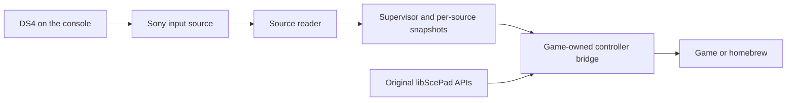

# Architecture and source guide

PoorDS4 separates the console input source from the application consuming it.
The source reader publishes per-controller packets; the supervisor manages
application/source lifetime; game-owned callbacks adapt the application's pad
imports.

## Source map

| File | Responsibility |
| --- | --- |
| `payload/game_pad_bridge_main.c` | Supervisor, application handoff, source recovery and packet publication. |
| `payload/wireless_ds4.c` | Source discovery, ABI validation, import installation, copied readers and game callbacks. |
| `payload/wireless_ds4.h` | Controller source, reader and status interfaces. |
| `payload/pad_types.h` | Controller record layout. |
| `payload/source_device_discovery.h` | Bounded device observation and ownership-aware refresh. |
| `payload/game_process_watch.h` | Application lifetime observation. |
| `payload/pad_feedback.h` | Feedback command and status layouts. |
| `payload/reader_rumble_channel.h` | Source-side feedback transport and handle ownership. |
| `payload/game_rumble_relay.h` | Per-controller feedback routing. |
| `payload/trigger_effect_state.h` | Validated trigger requests and per-controller cached state. |
| `payload/game_pad_bridge_status_main.c` | Finite diagnostic export. |
| `payload/stop_game_pad_bridge_main.c` | Normal owned shutdown request. |

## Read path

The five read callbacks are `game_pad_read_state_stub`,
`game_pad_read_state_ext_stub`, `game_pad_read_stub`, `game_pad_read_ext_stub`
and `game_pad_get_data_internal_stub` in `wireless_ds4.c`.

A validated DS4 binding receives its real source packet. Known native DualSense
bindings and unmatched handles use Sony's original path. A source binding does
not grant another controller's data to an unrelated handle.

Queued reads report one new bridged sample per publication and zero when the
publication repeats. An empty queued read retains the latest real packet in
sample zero: consumers that examine connection state on an empty update must
not see the disconnected game-local backing record. The zero return still
prevents duplicate queued events. Read capacities outside 1–64 retain the
original API path.

Source disconnection, expired leases, invalid arguments and native controllers
have explicit regression controls. Input and controller metadata use the same
source connection generation.

## Installation and lifecycle

`wireless_ds4_game_bridge_install` validates the selected application's pad
library and controller ABI before redirecting its import slots. It handles
both PLT and ordinary callable imports. The library's own text is unchanged.
A bounded PS4 title classifier preserves native PS4 passthrough.

Copied code lives in `.text.ds4reader` and `.text.ds4gamebridge`. Keep these
regions self-contained; their allocation, arguments and executable extents
must match the target ABI. Review final machine code when changing copied
callbacks or helpers.

Reader cleanup closes owned handles and retains borrowed handles. Application
handoff and recovery use current process/source evidence. Status exports,
normal stop requests and actual process disappearance are separate observations.

## Compatibility boundaries

Fixes operate on shared API, source ownership and lifecycle contracts. No
individual game title is selected for special input behavior. Firmware-specific
layout checks remain necessary; see [firmware support](FIRMWARE_SUPPORT.md).

Runtime simulation is a development aid. Host models and synthetic channels do
not establish physical multiplayer, radio hot-plug or rumble delivery.
See [testing](TESTING.md) for the validation matrix.
